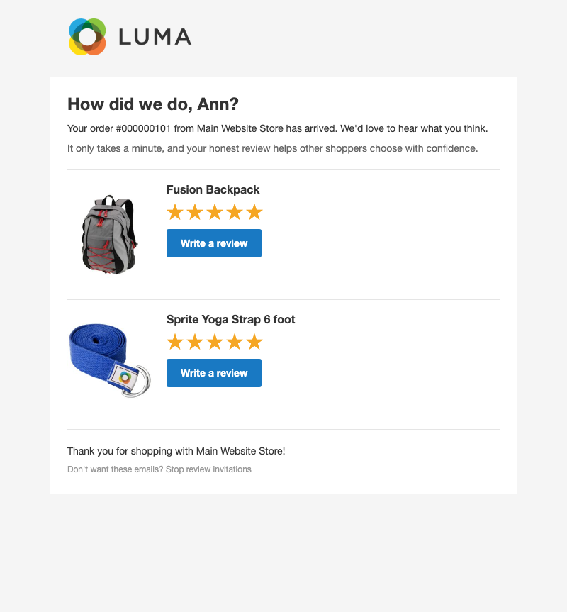

# Tonyapps_ReviewReminder

Automatically invite customers to review products from orders that have shipped. Magento Open Source supports product reviews, but it does not send post-purchase review requests or label a review as coming from a verified purchaser.

## Scope and decisions

| Feature | Decision |
|---|---|
| Who qualifies | Customer orders with a shipment and at least one shipped, reviewable product. Guests and registered customers are eligible. |
| Schedule | One message per order, sent N days after its most recent shipment. If a shipment is added later, the due date moves to N days after that shipment. Orders whose last shipment is more than N + 30 days old are skipped, so enabling the module never mails historical orders. A failed send is retried on the next cron run, at most 3 times, then marked failed (status 3). |
| Review link | Each product link opens Magento's core product review form. The invitation token is opaque and order-scoped; it does not log the shopper in or submit a review on their behalf. |
| Verified buyer | Associate logged-in customer reviews with matching shipped order items for the same customer and product. Display a “Verified Buyer” label on associated reviews. Guest reviews cannot be matched because core does not retain a reviewer email. |
| Repeat orders | A new order can receive its own invitation, including for a product previously purchased. |
| Opt-out | Include a tokenized unsubscribe link. GET only displays confirmation; POST opts that email address out of all future invitations. |
| Configuration | Store-scoped enable switch, delay in days, sender identity, and email template. Disabled by default. |
| Data | Dedicated invitation table with unique order and token. Keep core order, shipment, and review records as the source of truth. |

## Phases

1. **Invitation lifecycle:** schema, store configuration, cron selection, shipment-based due date, email with core review links, unsubscribe, and focused unit tests.
2. **Verified buyer (implemented):** associate reviews from signed-in customers with matching shipped order items, add the storefront badge, and cover customer/guest handling with unit tests. Core does not retain guest reviewer emails, so guest reviews remain unmarked.
3. **Manual verification:** install/upgrade check, exercise cron and review flow on a Magento instance, and inspect storefront output.

## Security and privacy

Invitation tokens are random, high-entropy credentials and are stored uniquely. They grant access only to the invitation and unsubscribe action, never to an account or order management. Escape customer and product data in email and storefront output. Do not persist review text outside Magento's review tables.

## 2026-10-30 review fixes

- The due-orders query filters `sales_shipment.created_at` in `WHERE` (not only `HAVING`), so the cron no longer scans the whole shipment history every 15 minutes.
- Closed (fully refunded) orders are skipped as well as canceled ones.
- Not changed: one invitation per order stays the design, so items shipped after the invitation was sent get no second invitation. "Verified Buyer" is not re-checked after a refund (product decision).

## 2026-11-10 QA fix

The invitation's product links end in `#review-form`, but Luma marks the Reviews tab active for that hash and keeps
its content hidden, so a shopper arriving from the email saw no form. `view/frontend/web/js/open-review-form.js`
(loaded on product pages) opens the Reviews tab and scrolls to the form when the page is reached with that hash.

## Emails

Screenshots of the emails as sent (Luma theme, 2026-11-09). Source images are in `docs/emails/`.

**Review invitation**



## Install

```sh
bin/magento module:enable Tonyapps_ReviewReminder
bin/magento setup:upgrade
```

## Tests

```sh
vendor/bin/phpunit -c dev/tests/unit/phpunit.xml.dist app/code/Tonyapps/ReviewReminder/Test/Unit
```

## Redesigning the emails

This module's emails can be redesigned visually with the [Email Designer](https://github.com/tonyappsorg/magento2-email-designer) (`Tonyapps_EmailDesigner`): open **Marketing › Communications ›
Email Designer**, start a design for the email and save it. Then pick the saved design in this module's email
template setting under **Stores › Configuration**. The default template is used until a design is picked.
